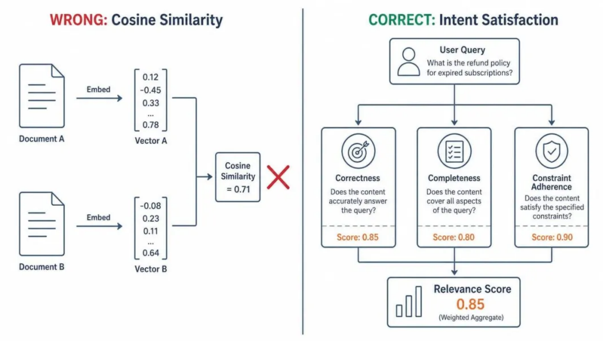
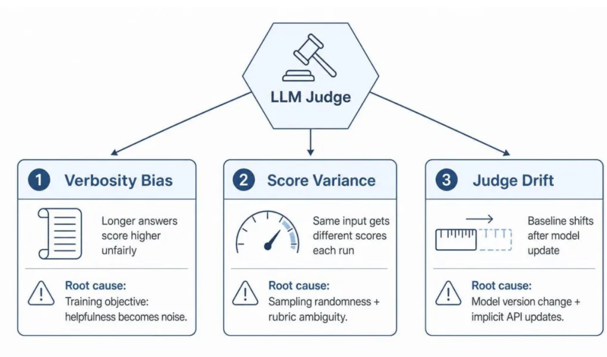
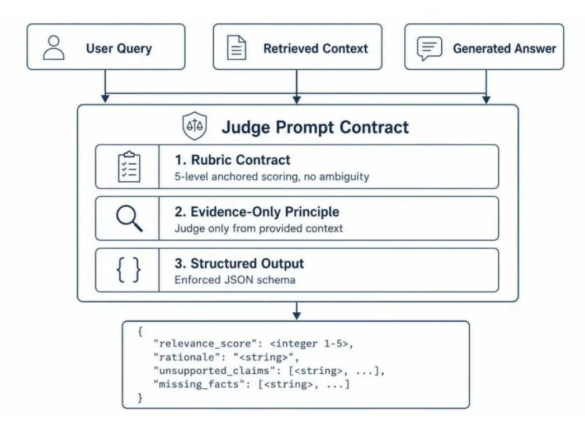
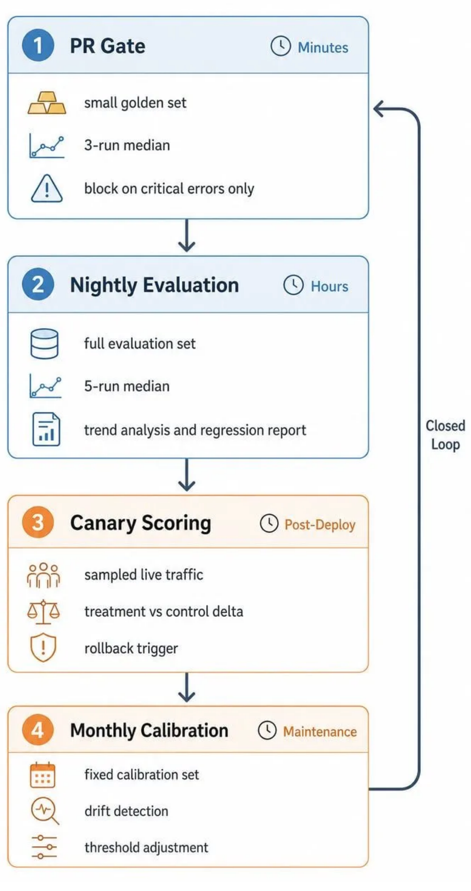

# LLM-as-Judge 如何做工程化校准

[TOC]

## 1. 问题

系统上线后，相同回答的分数值会随机波动：同一条 Query 今天跑出 4 分，明天变成 3 分，导致 代码 PR 被随机 Block。 

模型评价不客观：有时候冗长啰嗦的答案稳拿高分，精炼干脆的答案反而被扣分。 

更换Judge 模型，历史基线会全部偏移。


### Relevance 的本质是意图满足，而非语义相似

一个常见误解：Answer Relevance（答案相关性） 不是计算答案与 Query 的向量余弦相似度（Cosine Similarity）。 

因为余弦相似度本质上衡量的是文本表面的语义接近度。例如用户提问“如何在 Kubernetes 中配 置 HPA”，如果一个答案花了三段话详细解释 HPA 的历史、设计哲学和概念，其相似度得分会非常 高——因为每个词都和 HPA 相关。但对用户而言，这是一个不及格的答案，因为他想要的是具体 的操作步骤。 

因此，Answer Relevance 的核心定义应该是Intent Satisfaction（意图满足度）。它应该包含三 个可量化的物理维度： 

正确性：给出的信息是否事实正确 

完整性：用户问题的关键子问题是否都被覆盖 

约束遵循：格式、范围、长度等显式或隐式约束是否被满足 

这意味着一个看似相关但遗漏关键步骤的答案，Relevance 应该扣分；一个回答正确但附带大段无 关发散的答案，也应该扣分。



把 Relevance 理解成 intent satisfaction 而非 similarity，直接决定了后面的 Judge prompt 怎 么写、rubric 怎么定义、分数怎么锚定。


### 为什么需要自动评估

在最后一个环节，手工标注 Relevance 不是不可以，但在持续迭代的研发流程中，其频次和成本不断上升到无法承受的水平。 

一个高频迭代的 RAG 系统，每次修改 Prompt、更换切片策略（Chunker）、更新知识库或升级 Embedding 模型，都会引发答案质量的蝴蝶效应。如果每次改动都依赖人工评审， 一轮测试至少耗时一天。 

另外，实际研发中，团队往往在认真人工测评完两轮后就彻底放弃。此后代码合入便失去了质量校 验，上线全靠随机手动抽查，直到线上用户投诉集中爆发。

LLM-as-Judge 的核心价值在于将上述天级别的评审周期压缩至分钟级的 CI 级别：PR 合入前跑 一遍小规模 golden set，Nightly 跑一遍更大的评估集，发布后用 canary 抽样线上流量做评分。 

在自动化评估流水线中，人工不退出，但会承担校准（Calibration）和仲裁（Arbitration）的角 色


## 2. LLM-as-Judge 的三个系统性问题



偏差一：冗长偏差 (Verbosity Bias) 

LLM 天然倾向于给更长的答案更高分数。一个啰嗦但正确覆盖了要点的答案，和一个简洁直接命中 意图的答案，如果不显式约束，Judge 通常给前者更高分。 这种“看起来有用但无证据支撑”的信息，对人来说，这些是明显的发散；对 Judge 来说，却可能 被理解为答案更完整。 

偏差二：得分方差 (Score Variance) 

同一条 query、同一个答案，跑三次 Judge 可能出现 3、4、4 三个分数。如果你的 CI gate 阈值 设在 3.5，这意味着同一个 PR 能否合并全看运气。 方差来自两个层面。一是模型本身的采样随机性；二是 Prompt 规则的边界模糊性——当答案处于 3 分和 4 分的灰色地带时，模型因缺乏清晰的锚定物，每次判断都可能倒向不同方向。 当然，这种方差是无法避免的，我们要做的，是把方差控制在一个合理的范围区间内。

 偏差三：裁判漂移 (Judge Drift)

 Judge 的评估行为会随着模型版本的迭代而发生漂移。上个月针对 gpt-4-0613 校准的 4 分线， 这个月换成新版模型后，整体分数分布可能发生了系统性偏移。 除了模型迭代之外，Prompt 的暗箱迭代更为常见：工程师为了修复某个特定 Case 顺手调了一两 个词，却因为没有重新跑全量校准，也会导致 Judge 整体行为变得不可预测。


## 3. Judge Prompt 的工程化设计原则




### 1. Rubric Contract 

Judge prompt 里不能只写“请评价这个答案的相关性，打 1-5 分”。这等于把标准交给模型自由发 挥。 

一个工程化的 rubric 至少包含： 

- 每个分数档的锚定描述，不留解释空间 

- 明确的扣分条件：遗漏关键事实扣分、无证据的额外声明扣分、格式违规扣分 

- 明确的不评分条件：不因风格、语气、长短打分 

举一个 Relevance rubric 的锚定示例： 

```
5 - 完全正确，覆盖所有子问题，遵循约束，无无关内容
4 - 正确且基本完整，有少量遗漏但无错误，无无关内容
3 - 大部分正确但遗漏关键细节，或包含少量无支撑的额外声明
2 - 部分相关但缺失大部分关键事实，或存在明显错误
1 - 离题、错误、或未回答用户意图
```

rubric 越具体，模型的自由裁量空间越小，分数方差就越低。


### 2. Evidence-Only 原则

Judge 在评估 RAG 答案时，一个隐蔽的错误来源是：模型用自己的知识去判断答案对不对，而不 是根据提供的 context 来判断。 

如果 Judge 拥有 domain knowledge，它可能给一个事实正确但证据不支持的答案打高分，导致 掩盖 retrieval 问题，答案正确是因为模型自己知道，不是因为 context 提供了正确信息。 

解决方式是在 Judge prompt 里显式约束： 

```
你只能根据提供的 evidence 评估答案。
如果答案中的声明在 evidence 里找不到支撑，
即使该声明可能事实正确，也应视为无支撑。
```

这让 Judge 的评估结果和 retrieval 质量对齐：Relevance 分数下降时，你可以确信问题在答案本 身或 context 不足，而不是 Judge 用自己的知识“补”了分。


### 3. Structured Output

Judge 的输出不能是自由文本。自由文本意味着每次都要做正则提取，偶尔解析失败，且 rationale 格式不统一无法聚合分析。 

强制 JSON schema 输出： 

```
{
relevance: 4,
rationale: 覆盖了主要步骤但遗漏了权限配置部分,
unsupported_claims: [],
missing_facts: [RBAC 权限要求]
}
```

schema 带来三个好处：解析稳定、可以做自动化聚合分析、rationale 和分数绑定便于 debug。 输出解析失败时，有明确的 retry 和 fallback 策略，而不是吞掉错误当做“没有分数”。


## 4. 校准方法

### 4.1 Temperature 0 + Multi-run Median 

Temperature 0 是底线。但有时候，即使设了 0，部分 provider 仍有微小波动，针对这种模型的偶发随机性，我们可以采用Multi-run 机制：同一条评估请求并行跑 $$ 次（通常为 3-5 次），取 中位数（Median）而非平均数（Mean）作为最终得分。（这里取中位数的原因在于平均数对极端 值敏感。如果 5 次跑出 4、4、4、4、2，mean 是 3.6，median 是 4。那个 2 更可能是噪声而非真实判断。） 

另外，考虑到multi-run 的成本是调用量翻 N 倍。实践中我们可以分层处理：PR gate 用 3-run median 覆盖小规模 golden set；nightly 用 5-run median 覆盖更大的评估集；对高风险 bucket 追加更多 run。


### 5.2 人机对齐校验集 

校准的核心是拥有一套不可变、跨版本的固定校验集。该集合应包含几十条覆盖不同业务场景、不同质量档位的典型样本，且每条样本都带有资深专家标注的 Ground Truth 分数。（不能每次用不同的集合，否则你分不清是 Judge 变了还是集合变了。） 

这个集合的作用在于： 

- 每次修改 Judge prompt 后 ，跑一遍校准集 ，检查 Judge 分数和人工标注的对齐度（accuracy / correlation） 

- 每次切换 Judge 模型后，跑一遍校准集，检查分数分布是否偏移 

- 定期（按月）跑一遍校准集，检查 drift 

要注意，对齐度的衡量不是简单的 accuracy。因为 Relevance 是分档评分，更适合看： 

- 关键决策点的 precision / recall（比如“≥4 视为 pass”这个阈值下的 false positive / false negative） 

- 分数分布的整体偏移（是否系统性偏高或偏低） 

- 争议区间的 flip-rate（3 和 4 之间的样本，Judge 是否稳定）


### 5.3 Borderline Escalation 

当 Judge 打出的分数恰好卡在通过阈值附近（如阈值 3.5，得分为 3.4 或 3.6），或者 $$ 次运行 中最高分与最低分跨度超过 1 档时，说明该样本处于决策的模糊边界。

此时系统应自动触发Escalation（升级制）：调用性能更强、成本更高的模型（如从 GPT-4o-mini 切换到完整版 GPT-4o）或者增加 Multi-run 的采样次数进行二次二次仲裁。


## 评估流水线

一个健康的工程团队，应该根据速度、成本和覆盖度的不同，将校准好的 Judge 组装进四个不同 的研发阶段：



第一阶段，PR Gate（快速拦截层）：

代码合入前的强卡点。要求极速、极稳。采用几十条核心 Golden Set，以确定性的断言（如结构检查、关键词强匹配）为主，LLM Judge 为辅。宁可放宽 阈值，也绝不能因为模型抖动频繁误报打断开发节奏。 


第二阶段，Nightly Evaluation（全量回归层）：

每天夜间运行。可以容忍较高的时间和 Token 成 本，来运行全量评估集，产出各业务模块的质量趋势报告。执行中，单次波动不报警，一旦出现连 续趋势性下降则自动触发工单。 


第三阶段，Canary Scoring（线上验证层）：

线上真实流量的抽样灰度评估。核心逻辑是对比 A/B 测试中实验组（Treatment）与对照组（Control）的相对得分增量（Delta），而不是看绝对 值。这能有效避免因线上用户原生提问质量变差导致的主动误报。 


第四阶段，Monthly Calibration（自身体检层）：

每月重新运行固定标定集。一旦发现 Judge 标 尺发生系统性漂移，要么微调 CI 阈值以适配新裁判，要么将 Judge 模型回滚至上一个稳定版本。


