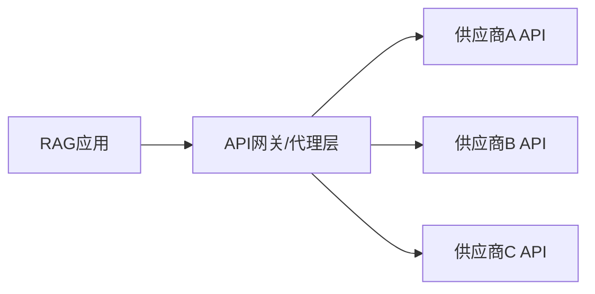
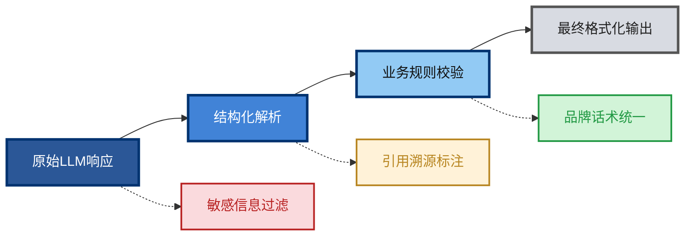

# Generation

[TOC]

## 生成模型集成

## 1. LLM API 集成模式

利用第三方提供的LLM API服务（如OpenAI GPT-4、Anthropic Claude、百度文心、阿里通义等）是快速构建RAG系统的常见选择。此模式关注点在于**可靠性**、**成本控制**与**性能优化。**

### 1.1 核心集成策略

- **异步与批处理调用**：为提升吞吐量，应采用异步非阻塞调用，并对多个用户查询进行智能批处理。
- **重试与熔断机制**：针对API限流、网络抖动等问题，实现指数退避重试和熔断器模式（如Hystrix、Resilience4j）。
- **多供应商降级**：集成多个LLM API供应商，在主供应商故障时自动切换，保障服务高可用。
- **Prompt工程与模板管理**：将Prompt设计为可配置的模板，与业务逻辑解耦，便于A/B测试和优化。

### 1.2 架构示意图



多供应商API集成与负载均衡架构

### 1.3 代码示例：带重试的API调用

```
import asyncio
import aiohttp
from tenacity import retry, stop_after_attempt, wait_exponential

class LLMAPIClient:
    def __init__(self, api_key: str, base_url: str):
        self.api_key = api_key
        self.base_url = base_url
        self.session = aiohttp.ClientSession(headers={'Authorization': f'Bearer {api_key}'})

    @retry(stop=stop_after_attempt(3), wait=wait_exponential(multiplier=1, min=2, max=10))
    async def generate_response(self, prompt: str, context: str) -> dict:
        """带指数退避重试的LLM API调用"""
        full_prompt = f"基于以下上下文：\n{context}\n\n请回答：{prompt}"
        payload = {
            "model": "gpt-4",
            "messages": [{"role": "user", "content": full_prompt}],
            "temperature": 0.7,
            "max_tokens": 1000
        }
        try:
            async with self.session.post(f"{self.base_url}/chat/completions", json=payload) as resp:
                if resp.status == 429:
                    raise Exception("Rate limit exceeded")
                resp.raise_for_status()
                return await resp.json()
        except aiohttp.ClientError as e:
            # 触发重试
            raise e

# 使用示例
async def main():
    client = LLMAPIClient("your-api-key", "https://api.openai.com/v1")
    response = await client.generate_response("什么是RAG？", "RAG是检索增强生成的缩写...")
    print(response['choices'][0]['message']['content'])
```


## 2. 本地模型部署方案

出于数据安全、合规性、长期成本或网络隔离考虑，企业常选择在自有基础设施上部署开源或自研的LLM。

### 2.1 部署模式对比

| 部署模式           | 优势                         | 挑战                            | 适用场景                     | 代表技术/模型                           |
| :----------------- | :--------------------------- | :------------------------------ | :--------------------------- | :-------------------------------------- |
| **单机全量部署**   | 架构简单，延迟低             | 受限于单机GPU内存，模型规模有限 | 中小模型（7B-13B），内部工具 | Llama 2/3, ChatGLM3, vLLM               |
| **多卡并行推理**   | 支持更大模型，提升吞吐       | 需要专业的并行策略与调优        | 大模型（70B+），高并发服务   | Tensor Parallelism, DeepSpeed Inference |
| **模型微服务化**   | 资源隔离，弹性伸缩，易于管理 | 引入网络开销与编排复杂度        | 云原生环境，多租户服务       | Kubernetes + Triton Inference Server    |
| **边缘轻量化部署** | 数据不出域，实时响应         | 需模型压缩与量化，精度有损      | 移动端、IoT、保密环境        | GGUF量化, ONNX Runtime, TensorRT-LLM    |

### 2.2 基于vLLM的高性能部署示例

```
# 使用 vLLM 部署本地模型并启动API服务
# 1. 安装: pip install vllm
# 2. 启动离线推理服务器：

from vllm import LLM, SamplingParams
from fastapi import FastAPI, HTTPException
from pydantic import BaseModel

app = FastAPI(title="Local LLM Service")

# 初始化模型（假设已下载模型至本地路径）
llm = LLM(model="/path/to/your/llama-2-7b-chat",
          tensor_parallel_size=2, # 双卡并行
          gpu_memory_utilization=0.9)

class GenerationRequest(BaseModel):
    prompt: str
    context: str
    max_tokens: int = 512

@app.post("/generate")
async def generate(request: GenerationRequest):
    """本地模型生成接口"""
    system_prompt = "你是一个专业的企业助手。请严格根据提供的上下文回答问题。"
    full_prompt = f"{system_prompt}\n上下文：{request.context}\n问题：{request.prompt}"

    sampling_params = SamplingParams(temperature=0.8,
                                     top_p=0.95,
                                     max_tokens=request.max_tokens)
    try:
        outputs = llm.generate([full_prompt], sampling_params)
        generated_text = outputs[0].outputs[0].text
        return {"response": generated_text}
    except Exception as e:
        raise HTTPException(status_code=500, detail=str(e))

# 使用 uvicorn 运行: uvicorn main:app --host 0.0.0.0 --port 8000
```


## 3. 响应生成与格式化

原始的LLM输出需要被加工成符合业务需求的标准化格式，这是确保RAG系统产出价值的关键环节。

### 3.1 结构化输出生成

- **指令遵循（Instruction Following）**：在Prompt中明确指定输出格式（如JSON、XML、Markdown）。
- **函数调用（Function Calling）**：利用LLM的function calling能力，直接输出结构化数据对象。
- **输出解析器（Output Parsers）**：使用LangChain、LlamaIndex等框架的解析器，将文本转换为Pydantic模型或字典。

### 3.2 企业级响应格式化流程




### 3.3 代码示例：使用Pydantic进行结构化解析

```
from pydantic import BaseModel, Field
from typing import List, Optional
from langchain.output_parsers import PydanticOutputParser

# 1. 定义期望的输出结构
class EnterpriseResponse(BaseModel):
    """企业级标准化响应格式"""
    answer: str = Field(description="对用户问题的直接、准确回答")
    confidence: float = Field(description="答案置信度，0-1之间", ge=0, le=1)
    sources: List[str] = Field(description="引用的文档来源ID列表")
    follow_up_questions: Optional[List[str]] = Field(description="建议的后续问题", default_factory=list)
    formatted_answer: Optional[str] = Field(description="包含Markdown格式的增强版答案")

# 2. 创建输出解析器
parser = PydanticOutputParser(pydantic_object=EnterpriseResponse)

# 3. 构建Prompt，指示LLM按格式输出
from langchain.prompts import PromptTemplate

prompt_template = """
你是一个企业知识库助手。
请根据以下上下文信息回答问题。
上下文：{context}
问题：{query}
请严格按照以下格式输出：
{format_instructions}
"""
prompt = PromptTemplate(
    template=prompt_template,
    input_variables=["context", "query"],
    partial_variables={"format_instructions": parser.get_format_instructions()}
)

# 4. 调用LLM并解析
def generate_structured_response(llm_client, context, query):
    formatted_prompt = prompt.format(context=context, query=query)
    raw_output = llm_client.generate(formatted_prompt) # 调用LLM
    try:
        structured_response = parser.parse(raw_output)
        # 后处理：添加品牌话术
        structured_response.formatted_answer = f"**蓝海科技为您解答：**\n{structured_response.answer}\n\n*置信度：{structured_response.confidence:.2%}*"
        return structured_response
    except Exception as e:
        # 解析失败时的降级处理
        return EnterpriseResponse(
            answer=raw_output,
            confidence=0.5,
            sources=[],
            follow_up_questions=[]
        )
```
