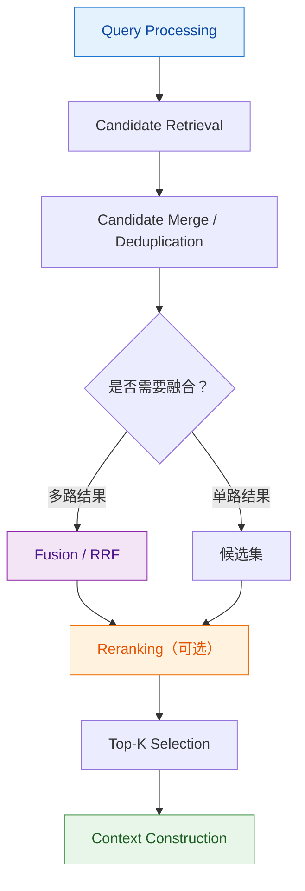
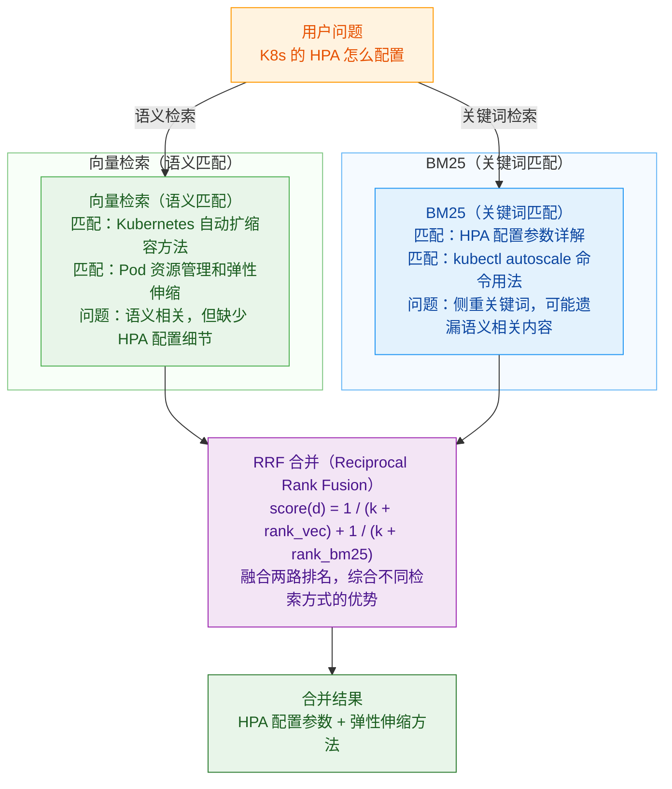

# Retrieval

[TOC]


## 0. 总览

核心目标：从知识库中找出与 Query 相关的候选文档，并在召回率、精确率、相关性、延迟和成本之间取得平衡。

Retrieval 的典型流程：




### 0.1 按检索方式分类

- **Dense Retrieval（稠密检索）**：基于 Embedding 和向量相似度，擅长语义匹配。
- **Sparse Retrieval（稀疏检索）**：基于关键词及倒排索引，擅长精确词项匹配。
- **Hybrid Retrieval（混合检索）**：结合 Dense 和 Sparse Retrieval。
- **Multi-way Retrieval（多路召回）**：通过多个检索器、查询或索引并行召回候选结果。
- **Metadata Filtering（元数据过滤）**：根据时间、部门、文档类型等结构化条件约束检索范围。


### 0.2 检索优化的不同层次

| 层次       | 核心问题                   | 主要方法                                |
| ---------- | -------------------------- | --------------------------------------- |
| 候选召回   | 相关文档能否被找出来？     | Dense、BM25、多路召回                   |
| 检索范围   | 应该搜索哪些数据？         | Metadata Filtering                      |
| 结果融合   | 不同检索器的结果如何合并？ | RRF、加权融合                           |
| 结果排序   | 哪些候选文档真正最相关？   | Reranker                                |
| 上下文选择 | 给 LLM 多少个文档？        | Top-K Optimization                      |
| 检索范式   | 如何处理复杂问题？         | Multi-hop、Iterative、Agentic Retrieval |

注意：这些不是完全互斥的算法分类。例如，Hybrid Retrieval 可以包含 Multi-way Retrieval；Metadata Filtering 可以发生在召回之前、召回过程中或召回之后，具体取决于检索系统。


## 一、检索


## 1. Dense Retrieval（稠密检索）

### 1.1 基本原理

将 Query 和 Document 编码为向量，通过向量相似度检索语义相关的文档。使用深度学习模型将文本映射为低维稠密向量，计算语义相似度。

常见相似度度量：

- Cosine Similarity
- Dot Product
- Euclidean Distance

优势：能够匹配不同表达方式的相似语义。理解语义，解决词汇鸿沟，泛化能力强。

局限：对精确编号、专有名词、缩写和罕见术语的匹配不一定可靠。领域适配需要训练数据，对领域外或表述差异大的查询可能失效。


### 1.2 Top-k 选择

1. 固定 Embedding 模型、数据集和其他检索参数。
2. 测试多个 K 值，例如 1、3、5、10、20。
3. 计算 Recall@K、MRR、NDCG 等检索指标。
4. 同时测量检索延迟、Rerank 延迟、上下文 Token 数和回答质量。
5. 选择满足质量要求且成本可接受的 K。

Recall@K 随 K 增大通常不会下降，但这不意味着回答质量一定持续提升。

K 过小：可能遗漏关键证据，导致回答不全。

K 过大：可能引入噪声、增加上下文成本，并使延迟上升。


### 1.3 索引与搜索算法：ANN（Approximate Nearest Neighbor）

ANN（近似最近邻）用于加速大规模向量检索。

核心思想：不是遍历所有向量找精确最近邻，而是通过索引结构快速找到足够接近的候选向量，以换取更低的检索延迟。


**主流 ANN 算法：**

#### 1. IVF（Inverted File Index）

- 原理：先对向量聚类，再搜索最近的几个簇。

- 核心参数：`nlist`（聚类簇数量）、`nprobe`（查询时搜索的簇数量）。
- 优势：可控精度，可调节搜索范围，适合超大规模向量检索。
- 代价：搜索的簇越少，延迟通常越低，但可能漏掉相关结果。


#### 2. HNSW（Hierarchical Navigable Small World）

- 原理：构建具有不同层级的近邻图。
- 核心原理
  - 多层图结构： 每个向量对应图中的一个节点，节点之间根据向量距离建立连接。底层包含全部节点，上层是逐渐稀疏的节点子集。
  - 分层导航： 从最高层的入口节点开始，逐步移动到与查询向量更接近的节点，再进入下一层继续搜索。
  - 近似最近邻搜索： 到达底层后，在一定的搜索范围内探索候选节点，返回最接近查询向量的 Top-K 结果。由于搜索范围受到控制，结果不保证是全局精确最近邻。
- 核心参数：
  - `M`：控制图的连接度，通常影响节点的邻居连接数量。增大 `M` 通常会增加内存消耗和建图成本，并可能改善搜索效果。
  - `ef_construction`：建图时的候选搜索宽度，越大通常建图越慢，图质量越好。
  - `ef` / `ef_search`：查询时的搜索宽度，越大通常召回率越高，但查询延迟也可能增加。
- 优势：查询速度快，召回率与延迟之间可以调节。
- 代价：内存占用通常较高。
- 直观理解：多层导航。可以把 HNSW 理解为一张具有不同导航尺度的地图：
  - 顶层： 几个向量，长距离连接，粗略导航
  - 中层： 更多向量，中距离连接
  - 底层： 全部向量，密集短距离连接，精确定位

- 复杂度从 O(N) 降到 O(log N)


#### 3. PQ / OPQ（向量量化与压缩）

- PQ（Product Quantization）：将向量划分为多个子空间，分别量化编码，以压缩向量存储。
- OPQ（Optimized Product Quantization）：通过优化向量空间的变换，改善量化效果。
- 优势：显著降低大规模向量检索的内存开销。
- 代价：量化会引入近似误差，精度有损。

（乘积量化）压缩向量维度


#### 4. Tree-based Index

- KD-Tree、Ball Tree 等基于树的索引。
- 在低维空间中可能有效；维度较高时，剪枝效果通常会退化。
- 高维向量检索中常见的方案还包括 HNSW、IVF 和量化方法。


## 2. Sparse Retrieval（稀疏检索）

### 2.1 基本原理

基于词频统计（如TF-IDF, BM25），将文档和查询表示为高维稀疏向量。

优点：精确匹配关键词，解释性强，无需训练。

缺点：无法处理词汇鸿沟，对同义词、语义泛化能力弱。


### 2.2 Inverted Index（倒排索引）

倒排索引建立从词项到包含该词项的文档列表的映射。

例如：

- `HPA → [文档 A, 文档 C]`
- `Kubernetes → [文档 B, 文档 C]`

查询时可以快速定位包含指定词项的文档，而不必逐篇扫描全文。


### 2.3 评分方法

#### 2.3.1 BM25

BM25 是经典的关键词检索排序算法。

核心因素：

- 词项在文档中的出现频率（TF）。
- 词项在整个语料中的区分能力（IDF）。
- 文档长度归一化。

优势：适合编号、缩写、产品名称、专业术语和精确关键词匹配。

局限：对同义词和不同表达方式之间的语义关联，通常不如 Dense Retrieval。


#### 2.3.2 TF-IDF


## 3. Hybrid Retrieval（混合检索）

Hybrid Retrieval 常见 Dense Retrieval + Sparse Retrieval ，即 Embedding + BM25 把两种检索方法并行跑


纯向量检索的三个致命问题 

① 精确匹配不行——用户搜"RFC 7231"，向量检索可能返回"HTTP 协议规范"这种语义相关但没提到 RFC 7231 的文档。因为它靠语义相似度，不是精确匹配。 

② 专业术语召回差——"K8s 的 HPA 怎么配置"，向量检索可能找的是"Kubernetes 自动扩缩容"，而 真正包含 HPA 配置细节的文档反而排不上。专业术语的向量表示和口语描述的向量表示距离可能很 远。 

③ 专有名词遗漏——产品名、人名、缩写这些，向量检索容易丢失。 


混合检索同时跑两路： （embedding 找语义近的 + BM25 找字面准的）

向量检索：抓语义相关的文档（"数据库优化"和"SQL 调优"能匹配上） 

关键词检索（BM25）：抓精确匹配的文档（"RFC 7231"能精确命中） 两路结果合并，取长补短。

两路并行

▸BM25 + Vector 两个独立检索

```
                ┌──→ BM25 (sparse, 精确字符串)─→ rank list A query ──┤                 └──→ Vector (dense, 语义相似)  ─→ rank list B
```

两条路径完全独立。BM25 跑倒排索引（inverted index），Vector 跑 HNSW（EP_008 讲过）。**物理上分开，架构上并存**。


## 4. Multi-way Retrieval（多路召回）

多路召回是更广义的策略：通过多个检索通道并行获取候选文档。

常见组合：

- Dense + BM25
- 多个不同的 Embedding 模型
- 原始 Query + Query Rewrite
- 不同 Metadata 条件下的检索
- 不同粒度或不同类型的索引


#### Multi-Retriever、Multi-way Retrieval、Hybrid Retrieval 的区别

| 概念                | 关注点                             | 例子                             |
| ------------------- | ---------------------------------- | -------------------------------- |
| Multi-Retriever     | 系统中有哪些检索器，如何组织和调用 | 创建多个 Retriever 并组合        |
| Multi-way Retrieval | 从哪些不同通道进行召回             | 原始 Query、改写 Query、多个索引 |
| Hybrid Retrieval    | 如何结合不同类型的检索方式         | Dense + BM25                     |


## 5. Metadata Retrieval

如果问题涉及精确数值、表格、筛选条件、聚合或业务统计，单纯的文本向量检索可能不是合适的主方案。

可以考虑：

- SQL 查询关系型数据库。

- 对结构化字段使用过滤和索引。

  - 使用结构化元数据约束检索范围，例如：

    - 文档类型：`type = "manual"`
    - 部门：`department = "finance"`
    - 时间范围：`date >= ...`
    - 权限：只允许访问当前用户有权读取的文档。

    需要注意：权限过滤不仅是提升检索精度的手段，也是企业 RAG 的访问控制要求。不能因为某个文档语义相关，就绕过权限约束。

- 使用文本检索与结构化查询混合的方案。


## 二、检索结果处理

将多路检索产生的候选结果合并、去重、过滤与融合，形成统一的候选列表，为后续上下文构建提供输入。

### 1. Candidate Merge

将向量检索、关键词检索等多路召回得到的候选文档或片段汇集到一起，形成统一的候选集合。

### 2. Deduplication

识别并去除重复的文档或片段，避免同一内容重复出现，浪费候选名额或上下文窗口。

### 3. Filtering

根据相关性、业务规则、文档状态或访问权限等条件，过滤不符合要求的候选结果。

注意：检索前的 Metadata Filter 用于约束召回范围；检索后的 Filtering 则用于进一步筛选已召回的候选结果。

### 4. Fusion

综合多个检索列表的排名或分数，形成统一的候选排序。

- **RRF（Reciprocal Rank Fusion）**：根据候选项在不同检索列表中的排名计算融合分数，不要求不同检索器的原始分数处于同一尺度。
- **Score Fusion**：对不同检索器的分数进行适当归一化或校准，再加权融合。


## 6. Fusion 融合策略

### 6.1 加权分数融合

对稀疏检索和稠密检索的分数进行归一化后，按权重相加。

```
final_score = α * normalize(sparse_score) + (1-α) * normalize(dense_score)
# α 为稀疏检索的权重，通常通过验证集调优获得。
```


### 6.2 RRF（Reciprocal Rank Fusion）结果集合并

RRF（Reciprocal Rank Fusion，倒数排名融合）是一种把多个检索器的排名结果合并成一个统一排名的方法，常用于 RAG 的 Hybrid Search（混合检索）和 Multi-way Retrieval（多路召回）。例子：BM25 分数 12.4 和 cosine 相似度 0.85 不可比（量纲不同、分布不同）


```
def reciprocal_rank_fusion(result_lists, k=60):
    scores = {}

    for results in result_lists:
        for rank, doc in enumerate(results, start=1):
            doc_id = doc.id
            scores[doc_id] = (
                scores.get(doc_id, 0.0)
                + 1.0 / (k + rank)
            )

    return sorted(
        scores.items(),
        key=lambda item: item[1],
        reverse=True,
    )
```

用 RRF 把多个排名列表融合成一个最终列表。

公式：$\operatorname{RRF}(d) =\sum_{i=1}^{m}\frac{1}{k+rank_i(d)}$

其中：

- `d`：候选文档。
- `rankᵢ(d)`：文档在第 `i` 路结果中的排名。
- `k`：平滑常数，通常设 60，不是检索结果的 Top-K 参数。

k 是一个平滑常数，用于控制不同排名之间的分数差距。

- 较小的 k：更强调排名靠前的文档，第一名与后续名次的分数差距相对更大。
- 较大的 k：分数差距更平缓，各排名的单次贡献更接近。

文档在多路检索中排名越靠前，累积得分通常越高。

RRF 使用的是排名，而不是原始相似度分数。因此，即使不同检索器的分数尺度不同，也可以融合。

**只用排名，不用分数**。两个 list 里都靠前的文档 RRF 分高，融合后排靠前。


其他融合方法：

- 加权分数融合。
- 合并候选集后去重。
- 合并候选集后交给 Reranker 排序。





### 为什么 RRF 出乎意料地有效

1. "Zero-shot" — 不需要训练 
2. 不需要分数归一化(BM25 vs cosine 量纲冲突全不用管) 
3. 跟谁都能配 — 加第三个 ranker(reranker / KG)直接 Σ


### Hybrid Search 默认 Fusion 算法与各数据库支持

| 类别            | 数据库 / 搜索引擎  | Fusion 支持方式                    |
| --------------- | ------------------ | ---------------------------------- |
| 默认采用 RRF    | Weaviate           | 默认使用 RRF                       |
| 默认采用 RRF    | Azure AI Search    | 支持 RRF 融合                      |
| 内置 Retriever  | Elasticsearch 8.9+ | 内置 RRF Retriever                 |
| Hybrid Pipeline | OpenSearch         | Hybrid Search Pipeline + RRF       |
| First-class API | Qdrant             | `Fusion.RRF`                       |
| 一行命令        | Redis 8.4          | `FT.HYBRID` 混合检索接口           |
| 特殊情况        | pgvector           | 通常需在应用层手动组合不同检索结果 |


## 7. 高级 Retrieval 范式

### Multi-hop Retrieval

需要结合多个事实或多个文档才能回答问题。


### Iterative Retrieval

先检索一轮，再根据中间结果更新查询或检索策略，进行下一轮检索。


### Recursive Retrieval

通过递归方式展开检索或处理层次化内容。


### Graph Retrieval

利用实体、关系和图结构查找关联信息，适合涉及多实体关联、关系查询和多跳关系的问题。

#### 1. 核心原理

知识图谱（Knowledge Graph，KG）将知识组织为实体及其关系构成的图，通常以三元组表示事实：

```
(头实体, 关系, 尾实体)
```

例如：`(Kubernetes, 包含组件, HPA)`。

图检索可以根据实体、关系和图结构查找关联信息，支持关系查询、邻居扩展和多跳路径查询。

#### 2. 知识图谱构建流程

构建 → 存储 → 查询 → 应用

1. 数据获取与清洗：爬取或导入数据，清洗并规范化文本。
2. 知识抽取：使用 DeepKE 等工具抽取实体、关系及属性。
3. 图存储：将抽取结果存入 Neo4j 等图数据库。
4. 查询与应用：通过图查询获取关联事实，可结合 Python 构建问答应用。
5. 可视化（可选）：使用 ECharts 等工具展示实体及关系网络。

#### 3. 知识图谱检索与向量检索对比

| 对比维度 | 知识图谱（KG）检索                                 | 向量检索                                                     |
| -------- | -------------------------------------------------- | ------------------------------------------------------------ |
| 检索依据 | 实体、关系、属性及图结构                           | Embedding 向量及相似度                                       |
| 优势     | 擅长明确的关系查询、多跳路径查询和结构化事实查询   | 擅长语义匹配、不同表达之间的关联和主题相关内容召回           |
| 局限     | 依赖图谱中已抽取并存储的知识，图谱质量影响检索效果 | 可能召回语义相似但实际不相关的内容，关系链查询通常需要额外机制 |
| 典型输出 | 实体、关系、属性、路径或结构化事实                 | 按相关性排序的文本块或其他向量化对象                         |
| 可解释性 | 高，答案路径清晰可溯                               | 低，相似度计算像一个黑盒                                     |

注意：这里比较的是知识图谱检索与向量检索，而不是完整的 KG 系统与传统 RAG。RAG 可以使用 BM25、向量检索、元数据过滤等多种技术；知识图谱也可以与文本检索结合使用。

#### 4. 与 RAG 的结合

知识图谱与 RAG 并非相互替代的方案，可以组合构建 GraphRAG 或混合检索系统。

- 知识图谱：提供实体、关系和结构化事实，适合明确的关系查询与多跳关联。
- 文本检索：召回相关文本片段，为问题提供原始资料、详细描述和上下文。
- 融合应用：根据问题类型结合图检索与文本检索，再对结果进行整合，交由 LLM 生成回答。

例如，回答“某个 Kubernetes 组件与哪些资源有关、它们之间是什么关系”时，可以通过图结构查找关联实体，再检索相关文档获取配置细节和使用说明。


### Agentic Retrieval

由 Agent 根据当前问题、检索结果和中间推理动态决定下一步搜索、工具调用或查询修改。

这些范式可以组合使用，并不是相互排斥的算法类别。


## 特殊检索策略：Parent-Child 与 RAPTOR

> Parent-Child 和 RAPTOR 都是 RAG 中用于优化检索效果的技术。Parent-Child 在索引阶段建立父子文本块关系，在检索阶段通过子块进行精准召回并返回父块作为上下文；RAPTOR 在索引阶段递归聚类并生成摘要，构建层次化树结构，在检索阶段利用不同层级节点实现多粒度检索。

一个关键区别：

- Parent-Child：主要解决检索粒度太小、上下文不完整的问题。Dify
- RAPTOR：主要解决长文档中信息分散、局部文本块难以表达高层语义的问题。RagFlow

### Parent-Child Retrieval

在索引阶段建立父块与子块之间的层次关系。

- 召回：通过较小的子块进行精准匹配。
- 返回：根据父子映射获取更大的父块作为上下文。

主要解决的问题：子块容易精确命中，但单独作为上下文时信息不完整。

### RAPTOR

通过递归聚类与摘要构建多层级的树形表示。

- 底层：较细粒度的文本块。
- 高层：聚类后生成的摘要节点。
- 检索：根据任务从不同层级获取细节或高层语义信息。

主要解决的问题：长文档中的信息分散在不同位置，单个局部文本块难以表达整体主题。

核心区别：

- Parent-Child：重点是子块召回与父块上下文扩展。
- RAPTOR：重点是通过递归聚类、摘要和树形结构实现多粒度检索。

两者主要涉及索引组织与检索策略的设计，可以与 Dense Retrieval、Hybrid Retrieval 和 Reranking 组合使用。


## 三、 Context Construction 模型上下文构建

从处理后的候选列表中选择合适的证据，组织成模型可以使用的上下文，并构建最终输入。

### 4.1 Top-K Selection

根据排序结果选择前 K 个候选片段，控制进入后续上下文构建流程的候选数量。


Top-K 表示最终保留多少个候选结果或上下文片段。

注意区分：

- **Candidate K**：召回阶段获取的候选文档数量。
- **Rerank K**：交给重排序模型处理的候选数量。
- **Final K**：最终交给 LLM 的文档或文本块数量。

这几个 K 不必相同。


### 4.2 Context Compression

压缩冗余内容，保留与用户问题相关的证据，减少上下文长度。


### 4.3 Context Ordering

调整上下文片段的排列顺序，兼顾相关性、信息逻辑与模型对不同位置内容的利用效果。


### 4.4 Prompt Construction

将用户问题、检索到的证据及相关指令组装为最终模型输入，供 LLM 生成回答。
