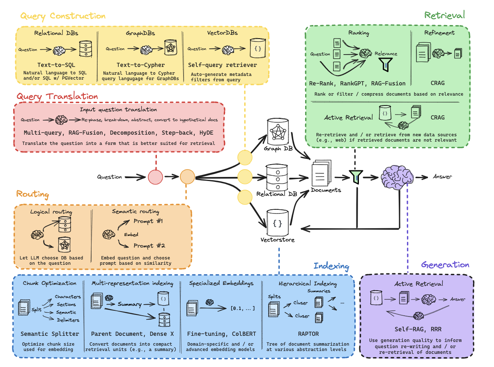

# 🌺 RAG

[TOC]

RAG（Retrieval-Augmented Generation，检索增强生成）：在 LLM 生成回答之前， 先从外部知识库检索相关信息，把检索结果塞进 Prompt，让 LLM 基于事实回答。

原因：

1. 模型训练数据存在截止时间，知识时效性有限；
2. 私有数据无法触达，如企业内部文档、客户数据和业务规则等信息；
3. 模型没有外部知识时容易产生幻觉，RAG 可以通过提供外部证据降低这类风险；
4. RAG 可以控制上下文质量，提供可追溯证据等。

## Offline

### DocumentProcessing

[[DocumentProcessing]]

### Chunking

[[Chunking]]

### Embedding

[[Embedding]]

### Indexing

[[Indexing]]

### VectorDatabase

[[VectorDatabase]]

## Online

### QueryProcessing

[[QueryProcessing]]

### Retrieval

[[Retrieval]]

### Rerank

[[Rerank]]

### Generation

[[Generation]]

## Evaluation

[[Evaluation]]

## References

1. RAG from Scratch：https://www.youtube.com/watch?v=sVcwVQRHIc8&t=5135s
2. datawhale-all-in-rag：https://github.com/datawhalechina/all-in-rag

